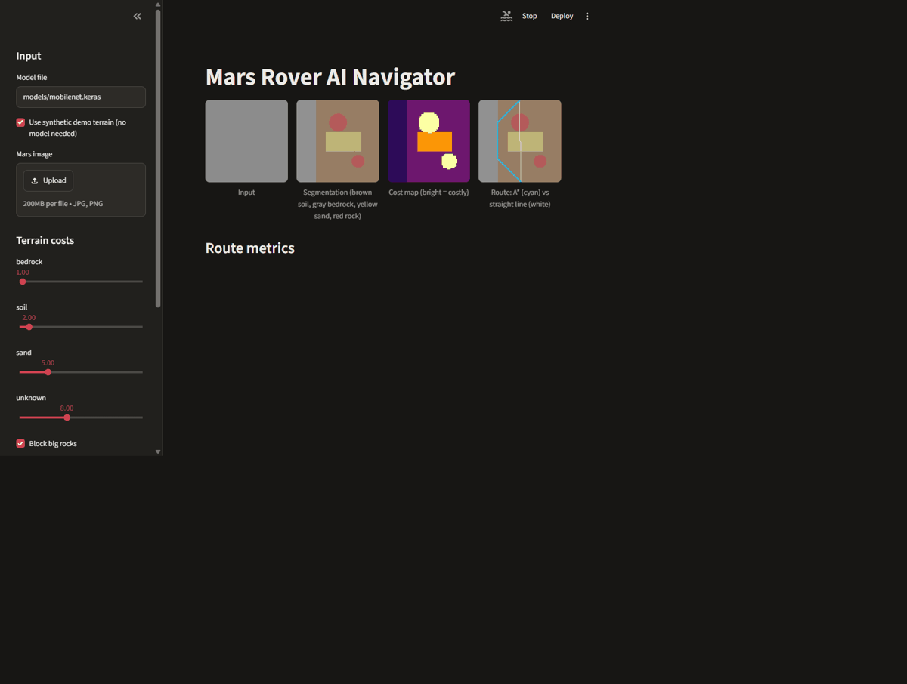

# Mars Rover AI Navigator

Terrain segmentation (U-Net) -> hazard cost map -> A* path planning -> Streamlit demo.
Course project for INT422 Deep Learning. Data: NASA/JPL AI4Mars.

## Pipeline
`rover image -> U-Net mask -> cost grid -> A* route -> Streamlit overlay`

## Live demo


## Setup
```bash
pip install -r requirements.txt
python scripts/inspect_dataset.py <dataset_root>     # shows the real folder layout
```
Labels: 0 soil, 1 bedrock, 2 sand, 3 big rock, 255 unlabeled (ignored in loss and metrics).

## Train (two models to compare)
```bash
python -m src.training.train --model unet      --images-dir IMAGES --labels-dir LABELS
python -m src.training.train --model mobilenet  --images-dir IMAGES --labels-dir LABELS
# quick first run: add  --max-images 500 --epochs 3
```
Models are saved to `models/`, curves and split to `outputs/`.

## Evaluate
```bash
python -m src.evaluation.evaluate --models models/unet.keras models/mobilenet.keras
```
Gives mIoU, mDice, pixel accuracy, per-class IoU, confusion matrices and prediction grids in `outputs/`.

## Run the app
```bash
streamlit run src/app/streamlit_app.py
```
Tick "synthetic demo terrain" to try the planner before any model is trained.

## Tests
```bash
python -m pytest tests -q
```

## Assumptions and limitations
- Rover images are ground-level, not top-down. The image is treated as an approximate 2D grid
  (rover at bottom-center, goal on the top row). This is a simplification.
- AI4Mars labels are crowd-sourced and noisy; "big rock" is rare, so its IoU will be low.
- Route quality has no ground truth; it is judged with proxy metrics (cost, length, % on safe terrain,
  hazard cells crossed) against a straight-line baseline.
- This is a simulation, not flight software.
- `find_pairs` matches images and labels by file name. I could not check the Kaggle mirror's exact
  folder layout, so run `scripts/inspect_dataset.py` first and adjust `--images-dir/--labels-dir`.

## Layout
```
configs/    costs.yaml, train.yaml
src/data/        dataset.py        pairing, split, tf.data, class weights
src/models/      unet.py           Model A (U-Net), Model B (MobileNetV2 U-Net)
src/training/    losses.py, train.py
src/evaluation/  metrics.py, evaluate.py
src/planning/    cost_map.py, planners.py
src/app/         streamlit_app.py
scripts/    inspect_dataset.py
notebooks/  train_kaggle_colab.ipynb
tests/      test_planning.py
```
